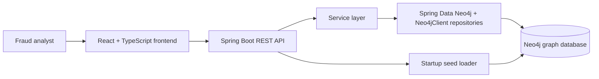
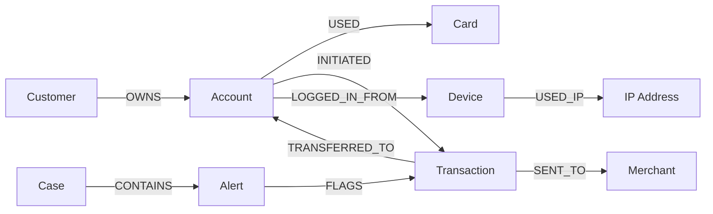

# FraudGraph Investigator

FraudGraph Investigator is a production-style portfolio project for graph-based fraud investigation. It combines a React + TypeScript analyst workspace, a Spring Boot REST API, and Neo4j graph modeling to investigate suspicious financial relationships.

The app is intentionally not mock-only: the backend seeds Neo4j with customers, accounts, cards, devices, IP addresses, merchants, transactions, alerts, and cases on first startup, then serves real graph queries to the UI.

## Architecture



## Data Model



## What Is Included

- 20 customers, 30 accounts, 15 devices, 10 merchants, and more than 100 transactions.
- Suspicious patterns for shared devices, circular transfers, merchant concentration, sub-threshold structuring, and proximity to previously suspicious entities.
- Spring Boot REST API with controllers, services, repositories, DTOs, mappers, validation, and exception handling.
- Cypher queries for shared devices, circular transfers, high-risk merchants, connected accounts within 2 hops, and suspicious transaction clusters.
- React Router pages for dashboard, alerts, investigation detail, graph explorer, and search.
- TanStack Query data access and React Flow graph visualization.
- Docker Compose setup for frontend, backend, and Neo4j.
- Focused backend and frontend tests.

## Run Locally

Prerequisites:

- Docker Desktop
- Java 21 and Node 22 only if running services outside Docker

```bash
cp .env.example .env
docker compose up --build
```

Open:

- Frontend: [http://localhost:5173](http://localhost:5173)
- API Swagger UI: [http://localhost:8080/swagger-ui.html](http://localhost:8080/swagger-ui.html)
- Neo4j Browser: [http://localhost:7474](http://localhost:7474)

Default Neo4j credentials are in `.env.example`.

## API Reference

| Method | Path | Purpose |
| --- | --- | --- |
| `GET` | `/api/dashboard/summary` | Dashboard metrics and typology counts |
| `GET` | `/api/alerts` | Prioritized alert queue |
| `GET` | `/api/alerts/{alertId}` | Alert detail with timeline, entities, graph, and actions |
| `GET` | `/api/search?q=acct` | Search graph entities |
| `GET` | `/api/graph/entity/{entityId}/neighborhood?depth=2` | Graph neighborhood |
| `GET` | `/api/detections` | Current suspicious pattern detections |
| `POST` | `/api/detections/run` | Run detection pass |
| `POST` | `/api/cases` | Create investigation case |
| `PATCH` | `/api/cases/{caseId}/status` | Update case status |
| `GET` | `/api/hypergraph/cases/{caseId}` | Event-centric hypergraph for an investigation case |
| `GET` | `/api/hypergraph/entities/{entityId}/neighborhood` | Hypergraph neighborhood for an entity |
| `GET` | `/api/hypergraph/events/{eventId}` | Single event hyperedge and participants |
| `GET` | `/api/hypergraph/patterns/suspicious-clusters` | Hypergraph suspicious cluster detections |

Example case request:

```json
{
  "title": "Coordinated mule review",
  "alertIds": ["alert-001", "alert-002"],
  "recommendedActions": ["Freeze outbound transfers", "Review shared device history"]
}
```

## Example Cypher Queries

Shared devices:

```cypher
MATCH (device:Device)<-[:LOGGED_IN_FROM]-(account:Account)
WITH device, collect(account) AS accounts
WHERE size(accounts) >= 3
RETURN device, accounts
ORDER BY size(accounts) DESC;
```

Circular transfers:

```cypher
MATCH (a1:Account)-[:INITIATED]->(:Transaction)-[:TRANSFERRED_TO]->(a2:Account)
      -[:INITIATED]->(:Transaction)-[:TRANSFERRED_TO]->(a3:Account)
      -[:INITIATED]->(:Transaction)-[:TRANSFERRED_TO]->(a1)
WHERE a1.id < a2.id AND a2.id < a3.id
RETURN a1, a2, a3;
```

Connected accounts within 2 hops:

```cypher
MATCH (suspicious)
WHERE coalesce(suspicious.previouslySuspicious, false) = true
   OR coalesce(suspicious.riskScore, 0) >= 85
MATCH path=(suspicious)-[*1..2]-(account:Account)
RETURN account, collect(DISTINCT suspicious.id) AS suspiciousIds, count(path) AS pathCount;
```

## Suspicious Patterns Detected

- Shared device cluster: multiple accounts authenticate from the same device and IP address.
- Circular money movement: funds travel through several accounts and return to the origin account.
- Merchant concentration: one merchant receives unusually high transaction volume from many accounts.
- Threshold structuring: wire amounts sit just below a common reporting threshold.
- Suspicious proximity: an account is within two graph hops of a previously suspicious entity.
- Transaction clusters: flagged transactions share infrastructure, merchants, or account neighborhoods.
- Hypergraph shared device pattern: multiple accounts participate in payment events through one device.
- Hypergraph merchant burst pattern: unrelated accounts participate in payment events with the same merchant.
- Hypergraph multi-entity similarity pattern: events share several participants such as device, IP, merchant, or card.

## Testing

Backend:

```bash
gradle :backend:test
```

Frontend:

```bash
cd frontend
npm install
npm test
```

Recommended end-to-end test path:

- Start `docker compose up --build`.
- Use Playwright to open `/`, verify dashboard metrics render, navigate to Alerts, open `alert-001`, then verify the investigation graph and recommended actions are visible.
- Add a Neo4j Testcontainers suite for repository Cypher tests in CI if this project is extended beyond portfolio scope.

## Screenshots

Add screenshots here after running locally:

- Dashboard command center
- Alert queue
- Investigation detail
- Graph explorer with filtered relationship types
- Search results

## Future Improvements

- Add analyst authentication and role-based authorization.
- Persist manual notes and case disposition history.
- Add incremental detection jobs instead of request-time pattern detection.
- Add Testcontainers-backed repository tests for full Cypher verification.
- Add graph layout persistence and saved investigation workspaces.
- Add alert assignment, SLA timers, and audit logging.

## Architecture Documentation

For investigative search, start with the [MVP status](docs/mvp-status.md), [target architecture](docs/target-architecture.md), [incremental roadmap](docs/mvp-roadmap.md), and [Phase 0.3 reconciliation](docs/architecture-reconciliation.md). The financial demo and authenticated synthetic preview are current capabilities. Imported-data persistence and its release gates are planned.

The original architecture assessment, technical debt report and PR roadmap below describe the demo-era baseline.

- [Architecture assessment](docs/architecture-assessment.md)
- [Hypergraph investigation model](docs/hypergraph.md)
- [ADR 0001: Event-centric hypergraph layer over Neo4j](docs/adr/0001-hypergraph-layer-over-neo4j.md)
- [Pull request roadmap](docs/pr-roadmap.md)
- [Technical debt report](docs/technical-debt-report.md)
- [Security notes](docs/security.md)
- [Testing strategy](docs/testing.md)
- [CI/CD](docs/ci-cd.md)
