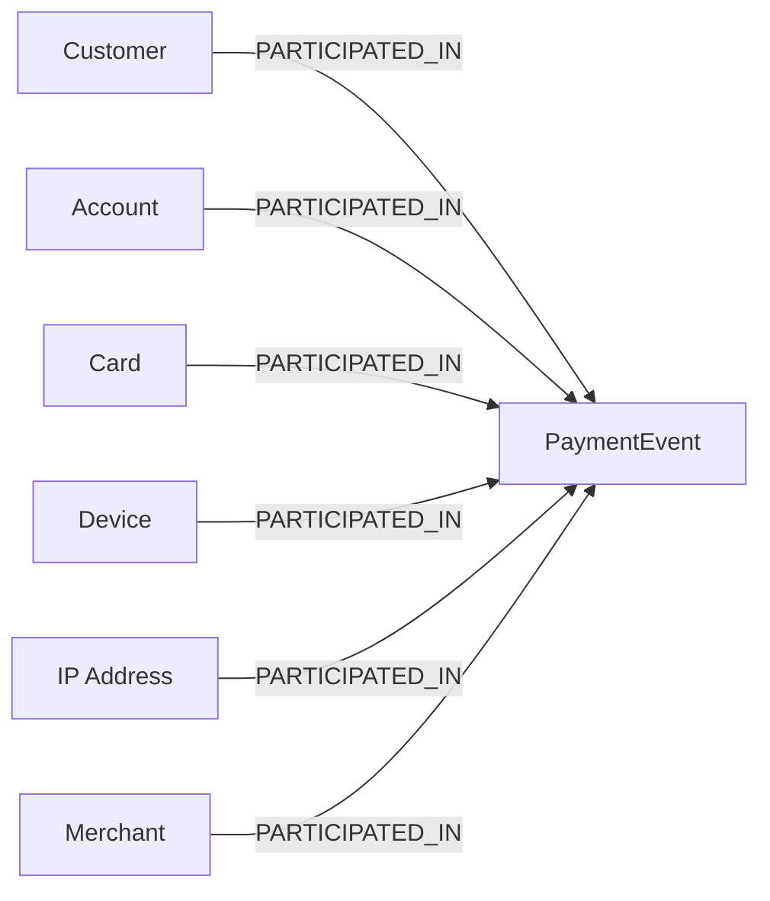

# Hypergraph Investigation Model

FraudGraph Investigator uses Neo4j for persistence and traversal, but exposes an event-centric hypergraph model to the application and frontend.

## Why Hypergraphs Matter

Pairwise relationships answer questions like:

- Which account sent money to which merchant?
- Which device logged into which account?

Hypergraphs answer richer investigation questions:

- What happened in this event?
- Which entities participated together?
- Which events share the same suspicious infrastructure?
- Why is this cluster suspicious?

For fraud analysis, the event is often the unit of meaning. A payment event can connect a customer, account, card, device, IP address, merchant, and location at the same time.

## Persistence Model

Neo4j stores hyperedges as event nodes. Participating entities connect to the event node using `PARTICIPATED_IN`.



## API Model

The frontend receives a clean DTO:

```json
{
  "nodes": [
    {
      "id": "cust-001",
      "type": "Customer",
      "label": "Avery Stone",
      "riskScore": 42,
      "metadata": {}
    }
  ],
  "hyperedges": [
    {
      "id": "payment-event-0001",
      "type": "PaymentEvent",
      "label": "$4,900 transfer",
      "riskScore": 87,
      "connectedNodeIds": ["cust-001", "acct-001", "dev-001", "merch-010", "ip-001"],
      "timestamp": "2026-01-01T10:30:00Z",
      "metadata": {}
    }
  ]
}
```

## Detection Rules

Initial hypergraph rules:

- Shared Device Pattern: multiple accounts participate in payment events through the same device.
- Shared Merchant Burst Pattern: many unrelated accounts participate in events with the same merchant in a short window.
- Multi-Entity Similarity Pattern: events share multiple attributes such as device, IP, merchant, location, or card fingerprint.

Each rule should return severity, involved nodes, involved hyperedges, explanation, and recommended analyst action.

