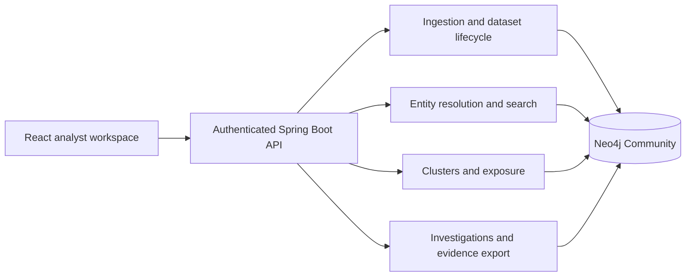

# Target Architecture

Preserve the Java/React modular monolith and Neo4j Community. Deploy on Compose behind a TLS reverse proxy, serving static frontend assets. Keep database ports private. The demo runs in a distinct profile and datastore from imported data.

Use feature packages `dataset`, `resolution`, `search`, `cluster`, `evidence` and shared access policy. Extend DTOs and reuse visualization components rather than exposing persistence nodes. Neo4j owns provenance, event links and analysis snapshots. Keep source files ephemeral and store only the canonical evidence needed for replay.

- A Dataset owns Accounts, Events, typed Identifiers, Devices, NetworkIdentifiers, Beneficiaries and Campaigns. Scope every node and relationship endpoint to the dataset. Reuse the Account and event concepts while containing legacy queries in the demo. Use uniqueness constraints on dataset plus typed external ID, with indexed exact lookup. Verify Community support and use a unique deterministic scoped key if needed.
- Represent participation with typed observed links such as INITIATED, OBSERVED_DEVICE, OBSERVED_NETWORK and PAID_TO. Keep Event as the hyperedge and separate source rows from derived evidence. Reward and Payout are financial event types for v1. Add a standalone Transaction only where the source identifies a distinct ledger record. Investigation and Evidence refer to immutable dataset version, source keys and rule version.
- Resolve exact typed identifiers within dataset scope. Shared device or network identifiers yield reviewable links, never account merges. Deduplicate observations. Explain rankings with identifier type, rarity, independent signals and time proximity. Report ambiguous and truncated results explicitly.
- Bound fan-out, depth, page size and server query duration before returning paths. Use versioned deterministic time-window and multi-identifier queries. No mandatory GDS. Consider it only after measured need and licensing review.
- Aggregate canonical events once per analysis, in integer minor units with checked values and per-currency totals. Persist the matched event keys and rule parameters so results can be reproduced until deletion. Evidence exports are access-checked again at download.

Draft ADR decisions for the implementation are dataset-scoped keys, event-based provenance and no cross-dataset links. Record accepted choices and migrations with Phase 1 once approved.
